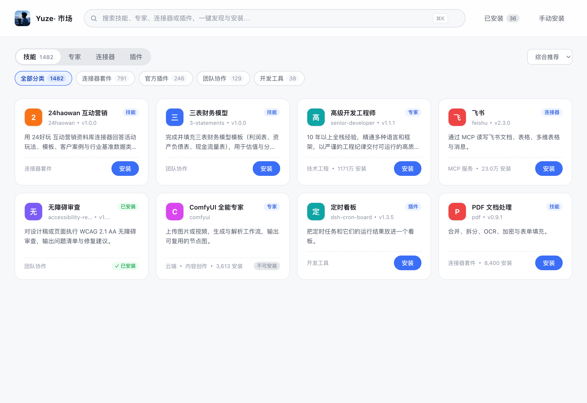

# Yuze-市场

DeepSeek Harness（DSH）的一体化市场插件：**技能 / 专家 / 连接器 / 插件** 四个板块，一个侧栏入口，统一浏览、安装与管理。

> 包名 `yuze-market` · 插件 id `yuze-market` · 连接器在宿主中显示为「Yuze-MCP 连接器」



## 它解决什么

QuWork 的技能与插件、WorkBuddy 的专家与连接器，原本分散在四个互不相通的市场里，命名、图标、安装方式各不相同。这个插件把它们归一成一套界面和一套操作：

| 板块 | 数据来源 | 规模 |
|---|---|---|
| 技能 | WorkBuddy 本地插件市场的 `skills/` + QuWork 技能市场 + WorkBuddy 在线市场（SkillHub，可整页浏览 + 关键词搜索 + 直接安装） | 1 500+ 本地 / 21 万+ 云端 |
| 专家 | WorkBuddy 在线专家市场快照 | 26 900+ |
| 连接器 | WorkBuddy 官方连接器市场（MCP） | 500 |
| 插件 | QuWork DSH 插件市场 | 36 |

所有条目统一为同一种卡片（图标、标题、类型、描述、分类、安装量）与同一个详情面板；安装、启用、停用、删除都走同一组接口。

## 功能

- **四板块网格**：胶囊 tab + 分类 chip + 排序（综合 / 最多安装 / 名称），最大四列自适应。
- **详情面板**：大图标、描述、版本、标识、标签、引导语（点击复制），可安装 / 启停 / 删除。
- **已安装视图**：不跟随 tab，一次列出全部内容并按类型分组，卡片式管理。
- **手动安装**：技能/专家支持目录或 zip，连接器支持粘贴 `mcp.json`，插件支持包名 / tgz / 目录。
- **连接器 OAuth**：授权码 + PKCE 全流程在插件内完成（本机回调 `127.0.0.1:17321`），token 写入 profile 的 MCP headers 并在过期后自动续期。
- **连接器 Hub**：向宿主的「连接器」面板注册一行市场标识 + 每个已安装 MCP 单独一行（图标、中文名、连接状态、启停开关）。
- **云端技能（SkillHub，21 万+）**：技能页常驻「云端技能」chip，点进去就是整个在线市场，按安装量排序、每页 60 条可一直加载（上游分页本身会重复，这里按会话去重后再补齐）；在搜索框输入两个字符以上则改走关键词搜索，命中行与本地结果合并展示。云端行带真实安装量与图标（图标由本机代理下载并缓存到 `~/.dsh/workbuddy-market/cache/cloud-icons`，不直连外链），点「安装」直接下载 SkillHub 的 zip 解包到 `~/.dsh/skills`。
- **中文标题 + 英文调用名**：卡片标题是市场给的中文名，副标题和详情里的「调用名」才是能敲的 `/travel-cn`。DSH 只接受 `^[a-z0-9]+(-[a-z0-9]+)*$` 的 `SKILL.md` 名（`@deepseek-ai/dsh-skill` 的校验，不合规的技能会被静默忽略），所以安装时把上游的中文 `name` 改写成目录名、原名存进 `title`，面板继续显示中文；已装列表按 `SKILL.md` 的真实名字调用，遇到非法名字会明确标成「调用名不合法」，而不是看起来装好了却调不出来。

## 安装

本地开发（推荐，改完 `pnpm build` 刷新即生效）：

```bash
git clone https://github.com/Hickey-Yuze/yuze-market.git
cd yuze-market
pnpm install
pnpm build
```

然后在 DSH 的活动 profile（`~/.dsh/profiles/desktop/package.json`）里加一行：

```json
"yuze-market": "link:/absolute/path/to/yuze-market"
```

并把 `yuze-market` 加进同一文件的 `dsh.profile.bundles`，最后 `pnpm install` 并重启 Harness。

或用发布包：

```bash
pnpm add "https://github.com/Hickey-Yuze/yuze-market/releases/latest/download/yuze-market-0.3.0.tgz"
```

## 数据快照

市场的条目不是实时拉取的：三份快照落在 `~/.dsh/workbuddy-market/cache/`，插件只读快照，因此断网或上游改版时是「数据旧一点」而不是「列表空」。

| 快照 | 生成命令 | 说明 |
|---|---|---|
| `catalog.json` | `pnpm build:catalog` | 连接器，扫描 WorkBuddy 官方市场包解析 `mcp.json` / 图标，并为 `/art` 建目录联接 |
| `skills-market.json` | `pnpm sync:skills` | 扫描 WorkBuddy 本地插件市场，秒级，不需要登录 |
| `experts-market.json` | `pnpm sync:experts` | 通过 WorkBuddy 自带 CDP 端口分页拉取在线专家市场（15–20 分钟） |
| `skills-zh.json` | `pnpm merge:zh` | 技能标题/描述的中文覆盖，缺失时回退英文；改动后按 mtime 热加载，无需重启 |

专家与技能之外的板块在快照缺失时会回退到内置数据源，不会白屏。

## 开发

```bash
pnpm typecheck     # 服务端 + 客户端类型检查
pnpm check         # 构建 + 类型 + 包契约 + 客户端 loader + OAuth + API + UI 全链路
```

`pnpm check` 里有 225 项断言，覆盖：

- OAuth 授权码 + PKCE 全流程（含取消、过期、无 refresh token）
- 市场 API（合并、排序、分页、图标、启停、删除、手动安装）
- 云端技能（SkillHub）：关键词搜索、整页浏览与去重、图标代理地址、zip 安装全链路
- 技能名规范：中文/带空格/缺 `name` 的标题在安装时改写成可调用的 kebab 名，中文存 `title`，已装列表按真实调用名索引
- 客户端渲染（卡片三态、详情、已安装视图、连接器 Hub 契约、目录选择器三级回退）
- 包契约（exports / `cordis.patch.yml` / client bundle 的 ModuleLoader 形状）

## 设计约束

写插件前值得知道的几条，都是踩过的坑：

1. **不要依赖宿主的 `--dsw-alias-*` 变量**：它们在插件 slot 内没有定义，会导致弹层透明、按钮文字与背景同色。样式自带 token。
2. **布局要在受限容器里验**（如 1180×640）：面板高度固定，flex 子项默认会被压缩；预览用自然高度页面看不出塌陷。
3. **Hub 的 `renderDetail` 必须返回 React 元素**：返回原生 DOM 会抛 `Objects are not valid as a React child`，整块「管理连接器」白屏。
4. **目录选择器没有文件版本**：宿主只提供目录选择（`/_dsh/desktop/pick-directory`），zip/tgz 只能手填路径。
5. **连接器只支持 stdio 与 streamable-http**：仅提供旧 SSE 传输的连接器会被拦截并说明原因。

## 已知限制

- 云端专家的 zip 走签名地址（约 24 小时有效），过期后需重跑 `pnpm sync:experts` 才能继续安装。
- 云端技能（SkillHub）不落本地快照：技能页的浏览与搜索都在线取数（客户端 5 分钟缓存），断网时只能看到上次缓存的那几页；云端图标按需代理下载，首屏会比本地行略慢。
- 技能标题来自上游，部分是英文专名（如 `pdf`、`3-statements`），中文说明在其后。
- 连接器 id 前缀仍为历史值 `mcp-wbm-`，仅影响配置文件内的标识，不影响显示。

## License

MIT
